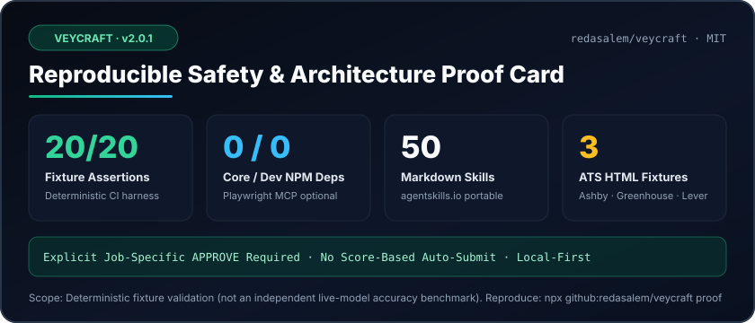

<div dir="rtl" align="right">

# Veycraft

### عمليات مهنية ومحرك ذكاء البروفايل وتفصيل سيرة ذاتية موثّق بالحقائق لوكيل الذكاء الاصطناعي الذي تستخدمه بالفعل.

*(سابقًا `job-hunter-os` — تحويلات GitHub التلقائية وأسماء أوامر CLI القديمة `job-hunter` و`job-hunter-os` ما زالت مدعومة بالكامل.)*

أعطِ وكيل البرمجة الذكي الذي تستخدمه حاليًا (`OpenAI Codex CLI`، `Claude Code`، `Cursor`، `Antigravity`، `Gemini CLI`، `GitHub Copilot`، `Windsurf`، `Cline`، `OpenCode`) سيرة ذاتية واحدة ووصف وظيفة واحدًا — أو اطلب ما تريد بلغة طبيعية بالعربية أو الإنجليزية. احصل على سيرة ذاتية مُفصّلة وموثّقة بالحقائق بصيغ `HTML / TXT / .doc متوافق مع Word`، وخريطة أدلة شفافة، ومقارنة كلمات `ATS`، وخطة تحديث بروفايل محققة بالمخطط، وقائمة صريحة بالمهارات الناقصة (`True Gaps`).

بدون خبرات مختلقة. بدون إرسال أعمى. بدون تبعيات `npm install`. بدون مفاتيح `API` خارجية. أنت دائمًا صاحب القرار.

**50 مهارة Markdown** · **0 تبعيات npm أساسية** · **محلي بالكامل (`Local-First`)** · **بتحكم بشري كامل**

**[معاينة تفاعلية ↗](https://redasalem.github.io/veycraft/)** · **[طرق البداية السريعة](#أسرع-طرق-البداية-بدون-تعقيد-إعداد-مسبق)** · **[التثبيت وربط أدوات AI](#التثبيت-وربط-أدوات-الذكاء-الاصطناعي)** · **[مرجع أوامر CLI](#مرجع-أوامر-cli-binclimjs)** · **[English](README.md)**

[](package.json)
[](skills/REGISTRY.md)
[](LICENSE)

<div dir="ltr" align="left">

```bash
# فحص محلي فوري لأي سيرة ذاتية (.md, .txt, .docx, .html, .doc) بدون أي إعداد مسبق
npx github:redasalem/veycraft audit ./resume.docx --share
```

</div>

---

## ماذا تعطي وماذا تستلم؟

جميع الأسماء والشركات والأرقام أدناه هي **بيانات عرض اصطناعية** من [`evals/fixtures/`](evals/fixtures/candidate-profile.md) لتوضيح شكل المخرجات الفعلية:


| المُدخلات منك | المخرجات الموثّقة التي تستلمها |
|---|---|
| سيرتك الذاتية (`.md` / `.txt` / `.docx` / `.html` / `.doc` / نص ملصق) — أو إنشاء/تعديل سيرة من الصفر | سيرة ذاتية أحادية العمود مفصّلة (**`HTML + TXT` + `.doc` متوافق مع Word** و`PDF` اختياريًا) مع إبقاء ملفك الأصلي سليمًا |
| وصف وظيفة، رابط إعلان، لقطة شاشة، أو مقارنة بين عدة وظائف | **خريطة أدلة (`Evidence Map`)**، **مقارنة كلمات `ATS`**، قائمة **الفجوات الحقيقية (`True Gaps`)**، ودعم الترجمة والتوطين (عربي RTL / إنجليزي / ألماني / فرنسي / إسباني) |
| نص/PDF/صور بروفايل LinkedIn أو جلسة متصفح محلية اختيارية | تدقيق **`DRAFT_ONLY` لـ LinkedIn** (`0–100`) وتوافق مع الـ CV، مسودة تواصل `<= 75` كلمة، **ملف تحضير للمقابلة**، وجدول قراءة `DOM` قبل `APPROVE` |

---

## مثال التحويل: قبل مقابل بعد

<div dir="ltr" align="left">

```diff
- Built backend APIs for an e-commerce and payments app using Node.js.
+ Built idempotent Node.js and TypeScript webhook processors backed by PostgreSQL and AWS SQS,
+ reducing payment webhook p95 latency by 38% across $4.2M daily settlement volume [verified: candidate-profile.md].
! Blocked claim: "Managed multi-cluster Kubernetes" (0 verified years — isolated under True Gaps)
[ATS Keyword Coverage: 71.4% -> 92.8% (heuristic comparison, not an ATS guarantee)]
[Status: dry_run: true · Awaiting explicit job-specific human APPROVE]
```

</div>

- **صفر خبرات أو أرقام مختلقة:** كل شركة ومسمّى وتاريخ وأداة ورقم يرتبط بحقيقة مؤكدة من ملفك، والمهارات غير الموجودة تُعزل بشفافية تحت **`True Gaps`**.
- **الصدق في الصيغ وتنقية الأسلوب:** لا يُعاد تسمية `HTML` ليبدو كـ `.docx` مزيف، وتُرفض ملفات PDF الممسوحة ضوئيًا كصور بوضوح مع طلب نسخة نصية، كما تُزال كليشيهات الذكاء الاصطناعي (`delve`, `spearheaded`, `synergy`).
- **صفر إرسال أعمى:** وضع `dry_run: true` مفعّل افتراضيًا؛ وكل تقديم حي أو تعديل حي على LinkedIn يتطلب موافقة بشرية صريحة (`APPROVE`) بعد مراجعة **جدول قراءة الـ DOM** أو التغييرات.

---

## أسرع طرق البداية (بدون تعقيد إعداد مسبق)

لا تحتاج إلى تسجيل دخول متصفح أو تشغيل `/setup` لتنفيذ المهام المستقلة:

### 1. اطلب باللغة الطبيعية مباشرة في محرّرك الذكي
يقوم موجّه المهام الشامل (`skills/REGISTRY.md` و`veycraft route`) باختيار أقل مجموعة مهارات مناسبة تلقائيًا:
- *"راجع ملف السيرة الذاتية `./my-cv.docx` واذكر الفجوات مقارنة بهذه الوظيفة."*
- *"عدّل ملخص الخبرة فقط بناءً على مشاريعي المؤكدة دون تغيير الملف الأصلي."*
- *"أنشئ لي سيرة ذاتية جديدة خطوة بخطوة."*
- *"راجع بروفايل LinkedIn الخاص بي واجعله متطابقًا مع السيرة الذاتية (`DRAFT_ONLY`)."*
- *"قارن هذه الوظائف ورتّبها حسب الملاءمة، ثم جهّزني للمقابلة."*

### 2. أو استخدم أوامر البداية السريعة

| المسار | الأمر | الوظيفة | المتطلبات |
|---|---|---|---|
| **1. تجربة فورية** | `/demo` | محاكاة اصطناعية خلال 15 ثانية عبر 3 وظائف تجريبية ([`examples/sandbox-demo/`](examples/sandbox-demo/sample-jds.md)) مع معاينة جاهزة للوظيفة الأولى | **لا يتطلب أي بيانات أو متصفح** |
| **2. أول سيرة حقيقية** | `/quick-tailor` | قراءة سيرتك + وصف وظيفة واحدة، تأكيد الحقائق، وإنتاج `HTML/TXT/.doc` مع `True Gaps` وفحص `verify` | **سيرتك + وظيفة واحدة فقط** (بدون دخول) |
| **3. بروفايل LinkedIn** | `/linkedin-growth` | تقييم (`0–100`) ومطابقة مع الـ CV واقتراحات `DRAFT_ONLY` (أي تعديل حي محمي بـ `APPROVE`) | **نص/PDF/صورة البروفايل** |
| **4. محرك ذكاء البروفايل** | `/profile-update` | تحليل ومزامنة البروفايل عبر LinkedIn ومواقع التوظيف بخطة تعديلات `DRAFT_ONLY` محققة بالمخطط والتحقق بعد الحفظ | **بيانات الـ CV + الدور المستهدف** |
| **5. النظام الكامل (اختياري)** | `login` ← `/setup` ← `/daily-run` | اكتشاف متعدد المصادر، فلترة الوظائف الوهمية، وتجهيز نماذج ATS بموافقة `APPROVE` | **متصفح + 5 بوابات جاهزية** |

---

## التثبيت وربط أدوات الذكاء الاصطناعي

**المتطلبات:** `Node.js >= 18` على **`macOS` أو `Linux` أو `Windows`**، مع أي محرّر أو CLI ذكاء اصطناعي تستخدمه بالفعل (بدون `npm install`).

### أ — التثبيت العالمي التلقائي (مُوصى به)
يهيئ `~/.veycraft` (ويكتشف تلقائيًا أي مجلد `~/.job-hunter-os` سابق ويحفظه دون فقدان بيانات) ويربط المهارات وإعدادات MCP بأمان **دون استبدال قواعدك الشخصية أو إعدادات TOML/JSON المخصصة**:

<div dir="ltr" align="left">

```bash
# ربط وتهيئة جميع محرّرات وأدوات الذكاء الاصطناعي المدعومة تلقائيًا
npx github:redasalem/veycraft init --global

# أو استهداف أداة محددة فقط:
npx github:redasalem/veycraft init --global --ide codex       # ~/.codex/AGENTS.md + config.toml + ~/.agents/skills
npx github:redasalem/veycraft init --global --ide gemini      # ~/.gemini/GEMINI.md + settings.json + ~/.gemini/skills
npx github:redasalem/veycraft init --global --ide claude      # ~/.claude/commands + ~/.claude/skills + ~/.claude.json
npx github:redasalem/veycraft init --global --ide cursor      # ~/.cursor/rules/job-hunter.mdc + ~/.cursor/mcp.json
npx github:redasalem/veycraft init --global --ide copilot     # ~/.copilot/copilot-instructions.md + mcp-config.json
npx github:redasalem/veycraft init --global --ide antigravity # ~/.gemini/antigravity/global_workflows + mcp_config.json
```

</div>

### ب — الاستنساخ والتشغيل المباشر محليًا
<div dir="ltr" align="left">

```bash
git clone https://github.com/redasalem/veycraft.git
cd veycraft
node ./bin/cli.mjs doctor
```

</div>

> **هل لديك نسخة قديمة من `job-hunter-os`؟** يحوّل GitHub الروابط القديمة تلقائيًا، ويمكنك تحديث الـ remote بالأمر:
> `git remote set-url origin https://github.com/redasalem/veycraft.git`
> مجلدات `~/.job-hunter-os` القائمة وأوامر `job-hunter` / `job-hunter-os` تبقى مدعومة بالكامل.

خيارات `--ide` المدعومة: `all, codex, gemini, copilot, claude, cursor, antigravity, opencode, windsurf, devin, cline, roo, kiro, junie, zed, goose, aider` — والتفاصيل في [`docs/COMPATIBILITY.md`](docs/COMPATIBILITY.md) و[`adapters/apps/openai-codex-cli.md`](adapters/apps/openai-codex-cli.md) و[`adapters/apps/gemini-and-copilot.md`](adapters/apps/gemini-and-copilot.md).

---

## مصفوفة القدرات والبدائل (بدون طريق مسدود)

| الحالة / توفر الأدوات | ما يعمل مباشرة | البديل والحد الآمن |
|---|---|---|
| **بدون Playwright MCP أو متصفح** | كل المهام المحلية: `audit`, `route`, `verify`, `/demo`, `/quick-tailor`, `/tailor-cv`, مراجعة LinkedIn بصيغة `DRAFT_ONLY`, تحليل ومقارنة الوظائف، التحضير للمقابلات، مراجعة العقود، والتتبع في `logs/` | التقديم التلقائي وتعديلات المتصفح غير متاحة؛ يسلمك المشروع الملفات والردود جاهزة للنسخ والرفع اليدوي |
| **مع Playwright MCP وتسجيل الدخول** | كل ما سبق **بالإضافة** إلى الاكتشاف التلقائي، تصدير `PDF` عبر المتصفح، تعبئة نماذج ATS وقراءة الـ DOM، والتحقق بعد حفظ LinkedIn | يتوقف فورًا عند أي CAPTCHA أو 2FA أو حظر مؤقت (تهدئة 24 ساعة) ولا يرسل إلا بعد `APPROVE` |
| **ملف PDF ممسوح ضوئيًا كصور** | قراءة `.docx` و`.html` و`.doc` و`.md` و`.txt` مدمجة؛ ورفض `.docx` المزيف والـ PDF الفارغ | لا يخمن الصور؛ يطلب لصق النص أو نسخة `.docx`/`.md` |
| **بدون Notion MCP / `NOTION_TOKEN`** | حفظ محلي كامل في `logs/` ولوحة Kanban عبر `dashboard` | يتخطى مزامنة Notion بهدوء وبدون أخطاء |

---

## بنية المستودع للمطورين (`Repository Map`)

<div dir="ltr" align="left">

```text
veycraft/
├── AGENTS.md                 # القواعد الأساسية، عقد المحادثة، مصفوفة البدائل (A–E)، والضوابط الـ 10
├── bin/cli.mjs               # أداة CLI خالية من التبعيات (init, audit, route, verify, eval, doctor, sync-mcp...)
├── skills/                   # 50 مهارة Markdown + الفهرس REGISTRY.md + skills-manifest.json
├── .agents/skills/           # 14 غلاف auto-discovery متوافق مع agentskills.io
├── .agent/workflows/         # مسارات أوامر المحرر (/demo, /quick-tailor, /setup, /daily-run...)
├── adapters/                 # أدلة ربط 25+ أداة ذكاء اصطناعي و6 عائلات نماذج
├── templates/                # قوالب HTML أحادية العمود للـ CV وخطاب التغطية ولوحة Kanban
├── config/                   # guardrails.yaml (dry_run: true افتراضيًا) و invariants.txt
├── context/                  # ملفات المستخدم الخاصة (ملفات .example عامة والباقي محجوب عن Git)
├── logs/                     # السجلات المحلية والملفات المُولّدة (محجوبة عن Git)
└── evals/                    # 20 اختبارًا حتميًا + 7 مجموعات اختبار رحلات (eval --journeys)
```

</div>

---

## الأمان والإثبات التقني (`eval --baseline` & `eval --journeys`)

<div dir="ltr" align="left">

```bash
node ./bin/cli.mjs eval --baseline   # 20/20 اختبارًا حتميًا للحقائق والحقن النصي ونماذج ATS
node ./bin/cli.mjs eval --journeys   # 7/7 مجموعات اختبار node:test (26 طلبًا + 5 سيناريوهات fallback + Codex/Gemini/Copilot)
node ./bin/cli.mjs proof             # إعادة توليد بطاقة الإثبات logs/exports/proof-card.svg
```

</div>



> **توضيح النطاق:** الأوامر `eval --baseline` و`eval --journeys` و`proof` تتحقق من النماذج المرجعية والمخططات وسلوك الـ CLI محليًا ([`evals/fixtures/ground-truth.json`](evals/fixtures/ground-truth.json) و[`evals/journeys/journey-matrix.json`](evals/journeys/journey-matrix.json)) وليست قياسًا عامًا لدقة النماذج الحية.

---

## مرجع أوامر CLI (`bin/cli.mjs`)

| الأمر | الوظيفة |
|---|---|
| `audit <cv.md\|txt\|docx\|html\|doc> [--share]` | فحص السيرة محليًا، كشف SSRF والتوكنات و`.docx` المزيف، وإنتاج بطاقة مشاركة خالية من PII |
| `route "<request>" [--json]` | توجيه أي طلب طبيعي لأقل مجموعة مهارات مناسبة مع البديل والمخرجات المتوقعة |
| `verify <dir\|file> [--facts <json\|md>]` | التحقق بعد الكتابة من خلو الملفات من `{{...}}` وشرطات AI والأرقام/المهارات غير المؤكدة |
| `init [--global] [--force] [--ide <name>]` | تهيئة المجلد أو `~/.veycraft` (مع الحفاظ على `~/.job-hunter-os` القديم) وربط المهارات وإعدادات MCP للمحرّرات |
| `sync-mcp [--global]` | مزامنة آمنة لـ Playwright وNotion في Codex `config.toml` وGemini `settings.json` و`.vscode/mcp.json` وCursor وClaude وCopilot |
| `doctor [--global] [--strict]` | فحص البيئة والبوابات الـ 5 و`50` مهارة وحداثة الكتيبات وخطاف الخصوصية |
| `eval [--baseline \| --file <json> \| --journeys]` | تشغيل الاختبارات الـ 20، أو تقييم مخرجات نموذج خارجي، أو اختبارات الرحلات السبع |
| `pre-submit [--draft <f> \| --text <t>]` | التحقق الحتمي من حد `<= 75` كلمة وحدود الإحماء اليومية |
| `proof` / `status` / `dashboard [--no-open]` | توليد بطاقة الإثبات، عرض ملخص الطلبات، أو فتح لوحة Kanban المحلية |
| `bundle` / `login` / `unlock` / `backup` / `update` | تصدير برومبت موحد لويب شات، فتح متصفح دائم، تنظيف أقفال المتصفح، نسخ احتياطي، أو تحديث موقّع بـ SSH |

---

## المساهمة والوثائق والرخصة

- **الوثائق المرجعية:** [`AGENTS.md`](AGENTS.md) · [`skills/REGISTRY.md`](skills/REGISTRY.md) · [`docs/ARCHITECTURE.md`](docs/ARCHITECTURE.md) · [`docs/SKILL_CATALOG.md`](docs/SKILL_CATALOG.md) · [`docs/COMPATIBILITY.md`](docs/COMPATIBILITY.md) · [`docs/execution-safety.md`](docs/execution-safety.md) · [`CONTRIBUTING.md`](CONTRIBUTING.md) · [`SECURITY.md`](SECURITY.md) · [`CHANGELOG.md`](CHANGELOG.md).
- **المساهمات مرحب بها:** إضافة نماذج ATS تجريبية، أو توثيق بوابات توظيف إقليمية، أو تحسين تكامل محرّرات الذكاء الاصطناعي، أو مشاركة نتيجة توظيف عبر [Share Outcome Issue](https://github.com/redasalem/veycraft/issues/new?template=share-success.yml).

مرخص تحت رخصة [MIT](LICENSE) — Copyright (c) 2026 Reda Salem (`@redasalem`). راجع [`NOTICE`](NOTICE) و[`AUTHORS.md`](AUTHORS.md) و[`PROVENANCE.json`](PROVENANCE.json).

---

## محرك ذكاء البروفايل (`/profile-update`)

طبقة ذكاء مشتركة وخالية من التبعيات (`skills/profile-intelligence-engine.md`، `bin/profile-intelligence.mjs`، `schemas/profile-update-plan.schema.json`) لتحسين ومزامنة ملفك المهني عبر LinkedIn وبوابات التوظيف الأخرى بصدق وكفاءة:

- **التشغيل:** اكتب `/profile-update` أو اطلب بلغة طبيعية (*"حسّن ملفي المهني"*، *"حدّث بروفايلي لهذه الوظيفة"*، *"زامن ملفي عبر مواقع التوظيف"*).
- **تحليل شامل ونزاهة الحقائق:** يقيّم الملاءمة، الكلمات المفتاحية، الوضوح، الأثر، التناسق، قابلية الاكتشاف، والجودة بالاعتماد على مخزن الحقائق المحلي (`schemas/resume-data.schema.json`) مع فصل تام بين الحقائق المؤكدة والاستنتاجات والبيانات الناقصة.
- **مسودة أولاً ومراجعة موحّدة:** يُنشئ خطة تعديلات (`add` و`replace` فقط بدون أي حذف `remove`) مع تخطي الحقول غير المتغيرة وعرض جدول مراجعة واحد شامل قبل أي تنفيذ.
- **محوّلات المنصات والتحقق الصادق:** يدعم محوّلات صريحة لـ `linkedin` و`wellfound` و`ats` و`job_boards` و`portfolio` ووضع `generic` الاحتياطي (قراءة/مسودة فقط للمواقع غير المعروفة). أي حفظ حي يتطلب موافقة صريحة (`APPROVE`) وجلسة مصرح بها، ويتم التحقق بعد الحفظ بقراءة حية (`verified` / `partially_applied` / `not_verified` / `blocked`).
- **التحقق عبر CLI والدوال البرمجية:** استخدم `node ./bin/cli.mjs verify <plan.json>` (أو `verify <resume-data.json>`) للتحقق الحتمي عبر CLI، بينما يوفّر `bin/profile-intelligence.mjs` دوال برمجية قابلة للاستيراد (`getPlatformAdapter`, `validateProfileUpdatePlan`, `validateProfileVault`, `formatConsolidatedReview`, `summarizeVerificationOutcome`).

</div>