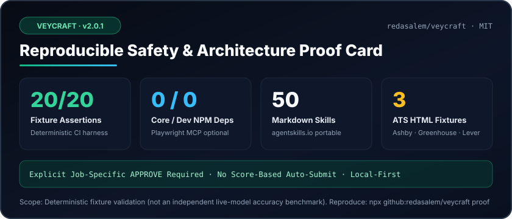

# Job Hunter OS

### Truthful CV Tailoring & Career Workflows for the AI Agent You Already Use.

Give your existing AI coding agent (**OpenAI Codex CLI, Claude Code, Cursor, Antigravity, Gemini CLI, GitHub Copilot, Windsurf, Cline, OpenCode**) one CV and one job description—or just ask in plain English or Arabic. Get a fact-checked tailored resume (`HTML` / `TXT` / Word-compatible `.doc`), a transparent **Evidence Map**, an **ATS Keyword Comparison**, and an explicit **True Gaps** list.

No fabricated experience. No blind submissions. No `npm install` bloat. No external API keys.

**48 Markdown Skills** · **0 Core/Dev npm Dependencies** · **Local-First (`logs/`, `context/`)** · **Human `APPROVE` Gate**

**[Interactive Demo ↗](https://redasalem.github.io/job-hunter-os/)** · **[Quick Start](#fastest-ways-to-get-started)** · **[AI Tool Setup](#installation--ai-tool-setup)** · **[CLI Reference](#cli-reference-binclimjs)** · **[العربية (RTL)](README.ar.md)**

[](package.json)
[](skills/REGISTRY.md)
[](LICENSE)

```bash
# Try an instant offline hygiene audit on any .md, .txt, .docx, .html, or .doc resume (zero setup)
npx github:redasalem/job-hunter-os audit ./resume.docx --share
```

---

## What You Give vs. What You Get

All names, employers, and metrics below come from synthetic repository fixtures ([`evals/fixtures/`](evals/fixtures/candidate-profile.md)) to illustrate the exact output produced by `/demo`, `/quick-tailor`, and natural-language CV tailoring:


| Input You Provide | Verified Output You Receive |
|---|---|
| Existing CV (`.md`, `.txt`, `.docx`, `.html`, `.doc`, text PDF, or pasted text) — or create/edit one from scratch | Single-column tailored CV (**`HTML` + `TXT` + Word-compatible `.doc`**, optional PDF via Playwright or browser Print-to-PDF) without altering your original CV file |
| One target JD, URL, screenshot, or batch discovery targets | Line-by-line **Evidence Map**, 4-bucket **ATS Keyword Heatmap**, explicit **True Gaps**, and optional bilingual localization (English / Arabic RTL / German / French / Spanish) |
| LinkedIn profile text, PDF export, screenshots, or optional browser session | **`DRAFT_ONLY` LinkedIn SEO Audit** (`0–100`), CV consistency check, `<= 75`-word outreach drafts, **`interview-dossier.md`**, and **Live DOM Read-Back Table** before `APPROVE` |

---

## Before vs. After Transformation

```diff
- Built backend APIs for an e-commerce and payments app using Node.js.
+ Built idempotent Node.js and TypeScript webhook processors backed by PostgreSQL and AWS SQS,
+ reducing payment webhook p95 latency by 38% across $4.2M daily settlement volume [verified: candidate-profile.md].
! Blocked claim: "Managed multi-cluster Kubernetes" (0 verified years — isolated under True Gaps)
[ATS Keyword Coverage: 71.4% -> 92.8% (heuristic comparison, not an ATS guarantee)]
[Status: dry_run: true · Awaiting explicit job-specific human APPROVE]
```

- **Zero invented claims:** Employers, titles, dates, tools, and metrics must trace back to your verified facts. Missing skills are never quietly added—they stay isolated under **True Gaps**.
- **Anti-AI slop & format honesty:** Strips generic clichés (`delve`, `spearheaded`, `synergy`) and prose em-dashes; never renames HTML to fake `.docx`; rejects scanned/image PDFs and asks cleanly for pasted text or `.docx`/`.md`.
- **No blind submissions:** Every live ATS form submission or LinkedIn edit requires an explicit, exact, job-specific human `APPROVE` after inspecting the **Live DOM Read-Back Table** or Before/After diff.

---

## Fastest Ways to Get Started

You do **not** need browser login, Playwright MCP, or full `/setup` onboarding for standalone tasks:

### 1. Just Ask in Plain Language (Inside Any Supported AI IDE or CLI)
Ask naturally—the **Universal Task Intent Router** ([`skills/REGISTRY.md`](skills/REGISTRY.md) & `job-hunter route`) loads only the minimal relevant skills without forcing `/setup`:
- *"Audit my CV at `./my-cv.docx` and show ATS gaps."*
- *"Tailor my CV for this job description (never invent skills)."*
- *"Change only the Professional Summary using my verified PostgreSQL latency metric."*
- *"Review my LinkedIn profile (`DRAFT_ONLY`) and align it with my CV."*
- *"Compare these 3 remote React roles and rank them with evidence."*
- *"Prepare me for this backend interview and review this offer/NDA."*

### 2. Or Use Fast-Start Slash Workflows

| Mode | Command | What It Does | Requirements |
|---|---|---|---|
| **1. Instant Sandbox** | `/demo` | Runs a 15-second simulation across 3 sample JDs ([`examples/sandbox-demo/`](examples/sandbox-demo/sample-jds.md)) with a full tailored preview for Job #1 | **None** (no CV, no browser) |
| **2. First Real Tailored CV** | `/quick-tailor` | Ingests 1 real CV + 1 JD, confirms facts, runs `verify`, and outputs `HTML`/`TXT`/Word `.doc` + True Gaps + interview prep | **CV + 1 JD only** (no login) |
| **3. LinkedIn Profile & SEO** | `/linkedin-growth` | Scores profile consistency against your CV (`0–100`) and writes `DRAFT_ONLY` improvements (live edit gated by `APPROVE`) | **Profile text / PDF / screenshot** |
| **4. Profile Intelligence** | `/profile-update` | Audits & syncs profiles across LinkedIn, job boards, ATS & portfolios via a schema-validated `DRAFT_ONLY` update plan | **CV/profile facts + target role** |
| **5. Full Career OS (Optional)** | `login` → `/setup` → `/daily-run` | Multi-board discovery, ghost filtering, form prep, `<= 75`-word outreach drafts, and tracking | **Browser login + 5 readiness gates** |

---

## Installation & AI Tool Setup

**Prerequisites:** Node.js `>= 18` on **macOS, Linux, or Windows**, plus any AI coding IDE or terminal agent you already use. Zero `npm install` dependencies required.

### Option A — Quick Global Setup (Recommended)
Run once to install `~/.job-hunter-os`, link skills into your AI tools, and safely merge Playwright MCP **without overwriting your personal rules or custom TOML/JSON settings**:

```bash
# Install and configure all detected AI IDEs & CLI harnesses globally
npx github:redasalem/job-hunter-os init --global

# Or target a specific AI tool only:
npx github:redasalem/job-hunter-os init --global --ide codex       # ~/.codex/AGENTS.md + config.toml + ~/.agents/skills
npx github:redasalem/job-hunter-os init --global --ide gemini      # ~/.gemini/GEMINI.md + settings.json + ~/.gemini/skills
npx github:redasalem/job-hunter-os init --global --ide claude      # ~/.claude/commands + ~/.claude/skills + ~/.claude.json
npx github:redasalem/job-hunter-os init --global --ide cursor      # ~/.cursor/rules/job-hunter.mdc + ~/.cursor/mcp.json
npx github:redasalem/job-hunter-os init --global --ide copilot     # ~/.copilot/copilot-instructions.md + mcp-config.json
npx github:redasalem/job-hunter-os init --global --ide antigravity # ~/.gemini/antigravity/global_workflows + mcp_config.json
```

### Option B — Clone Locally Inside a Workspace
```bash
git clone https://github.com/redasalem/job-hunter-os.git
cd job-hunter-os
node ./bin/cli.mjs doctor
```

*Supported `--ide` targets:* `all`, `codex`, `gemini`, `copilot`, `claude`, `cursor`, `antigravity`, `opencode`, `windsurf`, `devin`, `cline`, `roo`, `kiro`, `junie`, `zed`, `goose`, `aider` (see [`docs/COMPATIBILITY.md`](docs/COMPATIBILITY.md), [`adapters/apps/openai-codex-cli.md`](adapters/apps/openai-codex-cli.md), [`adapters/apps/gemini-and-copilot.md`](adapters/apps/gemini-and-copilot.md), and [`scripts/install.sh`](scripts/install.sh) / [`scripts/install.ps1`](scripts/install.ps1)).

> **Optional Browser & Notion Setup (Only When Needed):**
> ```bash
> npx github:redasalem/job-hunter-os login --global    # Sign in once to private browser-profile/
> npx github:redasalem/job-hunter-os sync-mcp --global # Sync Playwright (and Notion if NOTION_TOKEN is set)
> npx github:redasalem/job-hunter-os doctor --global   # Verify gates, playbooks & IDE configs
> ```
> Local `.mcp.json`, `.cursor/mcp.json`, `.codex/config.toml`, `.gemini/settings.json`, and `.vscode/mcp.json` are automatically gitignored and protected by `.git/hooks/pre-commit`.

---

## Capability & Fallback Matrix (No Dead-Ends)

Every task classifies missing tools honestly (`A–E`) and automatically switches to safe working alternatives:

| Scenario / Tool Availability | What Still Works Immediately | Honest Boundary / Fallback |
|---|---|---|
| **Offline / No Playwright MCP / No Login** | Natural-language tasks, `audit`, `route`, `verify`, `/demo`, `/quick-tailor`, `/tailor-cv`, LinkedIn `DRAFT_ONLY` audits from pasted text/PDF/screenshots, JD comparison, interview prep, offer/NDA audits, local JSON tracking, `dashboard` | Live browser submission and live LinkedIn clicks are disabled; delivers ready-to-paste answers & printable deliverables (`HTML` / `.doc` / `.txt`) |
| **Playwright MCP Connected (Browser Ready)** | All offline features **plus** live board discovery, automated Playwright PDF export, pre-filled ATS forms + Live DOM Read-Back, and post-save LinkedIn verification | Stops immediately on any CAPTCHA, 2FA, or rate limit (`24h` cooldown); never auto-submits without fresh `APPROVE` |
| **Scanned PDF / Fake `.docx` Input** | Built-in CLI reads real `.docx` (ZIP XML), `.html`, `.doc`, `.md`, `.txt`; detects disguised HTML `.docx` & zero-text PDFs cleanly | Never guesses unreadable image text—asks for a text `.docx`/`.md` export or pasted text |
| **No Notion MCP / `NOTION_TOKEN`** | Primary JSON ledger under `logs/` + HTML Kanban (`dashboard`) + Markdown/CSV/JSON exports | Skips Notion sync cleanly without errors |

---

## Repository Layout (Developer Map)

```text
job-hunter-os/
├── AGENTS.md                 # Canonical rules, NL contract, Capability Matrix (A–E), 10 Guardrails
├── bin/cli.mjs               # Zero-dependency Node CLI (init, audit, route, verify, eval, doctor, sync-mcp...)
├── skills/                   # 48 progressive-disclosure playbooks + REGISTRY.md + skills-manifest.json
│   ├── 00–26*.md             # Core career, CV, ATS, LinkedIn, negotiation, contract, safety & eval skills
│   ├── platforms/            # LinkedIn, Wellfound, Indeed/Glassdoor, remote, MENA & B2B boards
│   └── ats/                  # Greenhouse, Lever, Ashby, SmartRecruiters, BreezyHR, Workday, Taleo
├── .agents/skills/           # 13 agentskills.io SKILL.md discovery wrappers
├── .agent/workflows/         # IDE slash workflow entrypoints (/demo, /quick-tailor, /setup, /daily-run...)
├── commands/                 # Claude Code slash command wrappers
├── adapters/                 # 25+ AI IDE/CLI guides + 6 LLM family tuning guides
├── templates/                # ATS single-column resume HTML, cover letter HTML & local Kanban dashboard
├── config/                   # guardrails.yaml (dry_run: true default) & invariants.txt
├── context/                  # User profile, CV & answers (*.example committed; personal data gitignored)
├── logs/                     # Local JSON ledgers, tailored CVs & SVG exports (gitignored)
└── evals/                    # 20 deterministic safety assertions + 7-suite synthetic journey tests (eval --journeys)
```

---

## Safety Architecture, Technical Proof & Evaluations

Job Hunter OS clearly separates **code-enforced checks** from **LLM workflow instructions** (full details in [`docs/execution-safety.md`](docs/execution-safety.md)):

| Control Layer | What It Enforces | Concrete Examples |
|---|---|---|
| **Deterministic CLI Enforcement (`bin/cli.mjs`)** | Executed locally by zero-dependency Node.js with strict exit codes | `audit` (SSRF, secret-token & fake-`.docx` checks), `verify` (placeholders, prose em-dashes, unverified metrics/banned skills), `pre-submit` (`<= 75`-word cap & Days 1–3 warm-up cap), `route`, `.git/hooks/pre-commit` PII blocker, `backup`, `unlock`, SSH signature check in `update`, and `eval` |
| **Agent Workflow Requirements (`AGENTS.md`, `skills/*.md`)** | Structured rules followed by your AI model *(not an OS sandbox)* | Evidence mapping against confirmed profile facts, isolating missing skills in **True Gaps**, treating JDs as `UNTRUSTED_EXTERNAL_DATA`, upload-first ATS filling, Live DOM Read-Back, `DRAFT_ONLY` LinkedIn edits, and per-job `APPROVE` |

Reproduce both test suites and regenerate the proof card locally:

```bash
node ./bin/cli.mjs eval --baseline   # 20/20 deterministic safety, ATS & prompt-injection assertions
node ./bin/cli.mjs eval --journeys   # 7/7 node:test suites (26 NL prompts, 5 fallback scenarios, Codex/Gemini/Copilot sync)
node ./bin/cli.mjs proof             # Regenerates logs/exports/proof-card.svg from live manifest & evals
```



> **Honest Eval Scope:** `eval --baseline`, `eval --journeys`, and `proof` perform **deterministic fixture, CLI, and integration verification** against [`evals/fixtures/ground-truth.json`](evals/fixtures/ground-truth.json) and [`evals/journeys/journey-matrix.json`](evals/journeys/journey-matrix.json)—they are **not** a benchmark of external live-model accuracy. External model outputs are graded via `eval --file evals/results/live-agent-eval-run.json` (`20/20 PASS`). Live browser automation depends on target portal layouts and user authentication.

<details>
<summary><strong>Inspect 20 Fixture Assertions + 7 Synthetic Journey Test Suites + ATS Support Tiers</strong></summary>

| Suite | Scope Verified | Status |
|---|---|---|
| **Fixture Baseline (`EVAL-01..20`)** | Anti-hallucination, Kubernetes isolated in `true_gaps`, `0` AI slop/em-dashes, 1-page A4 fit, prompt-injection & `PINEAPPLE` attention checks, >90d ghost/blacklist/dedup, Greenhouse/Lever/Ashby Upload-First + honeypot + DOM Read-Back + 24h cooldown | **20 / 20 PASS** |
| **Synthetic Task Journeys (`eval --journeys`)** | Test 1: 26 NL prompts routed without `/setup` · Test 2: Offline skill `requires_mcp: []` parity · Test 3: `.md/.txt/.html/.doc/.docx` import & scanned-PDF/fake-`.docx` rejection · Test 4: Original-preserving CV edit + iterative revision + `verify` · Test 5: LinkedIn `DRAFT_ONLY` + multi-source JD + `prepared` vs `applied` · Test 6: 5 fallback scenarios · Test 7: Codex TOML/`AGENTS.md`, Gemini CLI, Copilot/VS Code & custom rule preservation | **7 / 7 PASS** |
| **ATS Tiers (`PLATFORMS.md`)** | **Fixture-Verified:** Greenhouse, Lever, Ashby · **Playbook-Ready:** Workday (manual fallback), SmartRecruiters, BreezyHR, LinkedIn, Wellfound · **Help Wanted:** Regional boards | Continuous CI (`Ubuntu`, `macOS`, `Windows`) |

</details>

---

## CLI Reference (`bin/cli.mjs`)

| Command | Purpose |
|---|---|
| `audit <cv.md\|txt\|docx\|html\|doc> [--share]` | Offline CV hygiene, word/page fit, metric/SSRF/token scan + shareable PII-safe SVG/MD card |
| `route "<request>" [--json]` | Deterministic natural-language Task Intent Router showing matched skills, readiness & fallback |
| `verify <dir\|file> [--facts <json\|md>]` | Post-write deliverable verifier (placeholders, fake `.docx`, prose em-dashes, unverified facts) |
| `init [--global] [--force] [--ide <name>]` | Scaffold workspace or `~/.job-hunter-os`, install IDE skills/rules & sync MCP configs |
| `sync-mcp [--global]` | Safely merge Playwright (and optional Notion) into `.mcp.json`, Cursor, Claude, Codex `config.toml`, Gemini `settings.json`, Copilot & `.vscode/mcp.json` |
| `doctor [--global] [--strict]` | Verify Node version, 5 gates, 48-skill manifest, `<60d` playbooks, links, PII hook & MCP files |
| `eval [--baseline \| --file <json> \| --journeys]` | Run the 20 fixture assertions, external run grading, or 7 `node:test` integration suites |
| `pre-submit [--draft <file> \| --text <str>]` | Enforce `<= 75`-word outreach limit and daily / Days 1–3 warm-up caps against `logs/` |
| `proof` / `status` / `dashboard [--no-open]` | Generate proof card SVG/MD, inspect funnel & warm-up caps, or open local Kanban viewer |
| `bundle` / `login` / `unlock` / `backup` / `update` | Export single-file web-chat prompt, open persistent Chromium, clean stale locks, verify & snapshot JSON logs, or update with SSH commit signature check |

---

## Documentation Index & Contributing

- [**`AGENTS.md`**](AGENTS.md) & [**`skills/REGISTRY.md`**](skills/REGISTRY.md) — Canonical agent rules, NL Task Router (**48 skills**), and 10 guardrails
- [**`docs/ARCHITECTURE.md`**](docs/ARCHITECTURE.md) & [**`docs/SKILL_CATALOG.md`**](docs/SKILL_CATALOG.md) — 6-phase pipeline and complete `48`-skill index (`30` core, `4` meta, `7` platform, `7` ATS)
- [**`docs/COMPATIBILITY.md`**](docs/COMPATIBILITY.md) & [**`docs/chat-commands.md`**](docs/chat-commands.md) — 25+ AI IDE setups, 6 LLM tuning guides, and command cheat sheet
- [**`docs/execution-safety.md`**](docs/execution-safety.md), [**`SECURITY.md`**](SECURITY.md) & [**`CHANGELOG.md`**](CHANGELOG.md) — Safety boundaries, vulnerability disclosure, and release notes
- [**`CONTRIBUTING.md`**](CONTRIBUTING.md) & [**`HIRED.md`**](HIRED.md) — Add ATS fixtures, regional board playbooks, IDE adapters, or share outcomes via [Share Outcome Issue](https://github.com/redasalem/job-hunter-os/issues/new?template=share-success.yml)

---

## License & Attribution

Inspired by open-source patterns from **[`career-ops-hq/career-ops`](https://github.com/career-ops-hq/career-ops)**, **[`obra/superpowers`](https://github.com/obra/superpowers)**, and **[`anthropics/skills`](https://github.com/anthropics/skills)** / **[`agentskills.io`](https://agentskills.io/)**.

Licensed under the [MIT License](LICENSE) — Copyright (c) 2026 Reda Salem (`@redasalem`). See [`NOTICE`](NOTICE), [`AUTHORS.md`](AUTHORS.md), and [`PROVENANCE.json`](PROVENANCE.json).

## Supported & Universal Job Platforms

Works out-of-the-box with major global, regional, and ATS platforms — **plus any custom HTTPS job URL** via `/apply-url`:
- **Global & Remote Boards:** LinkedIn (Easy Apply & External), Indeed, Glassdoor, Wellfound (AngelList), RemoteOK, We Work Remotely, Otta, Himalayas, Built In
- **MENA & Regional:** Wuzzuf, Bayt, Naukrigulf
- **Direct ATS Platforms:** Greenhouse, Lever, Ashby, Workable, SmartRecruiters, Workday, BambooHR, Breezy HR
- **B2B & Contract Networks:** Toptal, Braintrust, Lemon.io, Gun.io, Contra, Arc.dev, Turing (`skills/platforms/b2b-contract-networks.md`)
- **Any Custom URL:** Paste any job link from any company career page or board; the AI reads the live DOM semantically (`Role -> Label -> Placeholder -> Text`) without needing a pre-built site template.

---

## Profile Intelligence Engine (`/profile-update`)

Shared, zero-dependency intelligence layer (`skills/profile-intelligence-engine.md`, `bin/profile-intelligence.mjs`, `schemas/profile-update-plan.schema.json`) for keeping your professional profile sharp, honest, and consistent across LinkedIn and other job platforms:

- **How to trigger:** Run `/profile-update` or ask naturally (*"Optimize my professional profile"*, *"Update my profile for this job"*, *"Sync my career profile across platforms"*, *"Update my job board profiles"*).
- **7-criteria audit & fact integrity:** Evaluates Relevance, Keyword coverage, Clarity, Impact, Consistency, Discoverability, and Quality against your local verified profile vault (`schemas/resume-data.schema.json`). Separates `verified_facts`, `user_confirmed_facts`, `inferred_info`, and `missing_info`—never promotes inferences or fabricates experience.
- **Draft-first consolidated review:** Outputs a schema-validated `Profile Update Plan` (`add` and `replace` actions only; zero `remove`) and one field-level diff table. Unchanged fields are skipped automatically (`skipped_unchanged`).
- **Platform adapters & honest limitations:** Supports declarative adapters for `linkedin`, `wellfound`, `ats`, `job_boards`, `portfolio`, and a conservative `generic` read/draft-only fallback for unknown sites. Live filling/saving requires explicit user `APPROVE`, an authorized browser session, and fresh post-save read-back verification (`verified`, `partially_applied`, `not_verified`, `blocked`, or `needs_review`).
